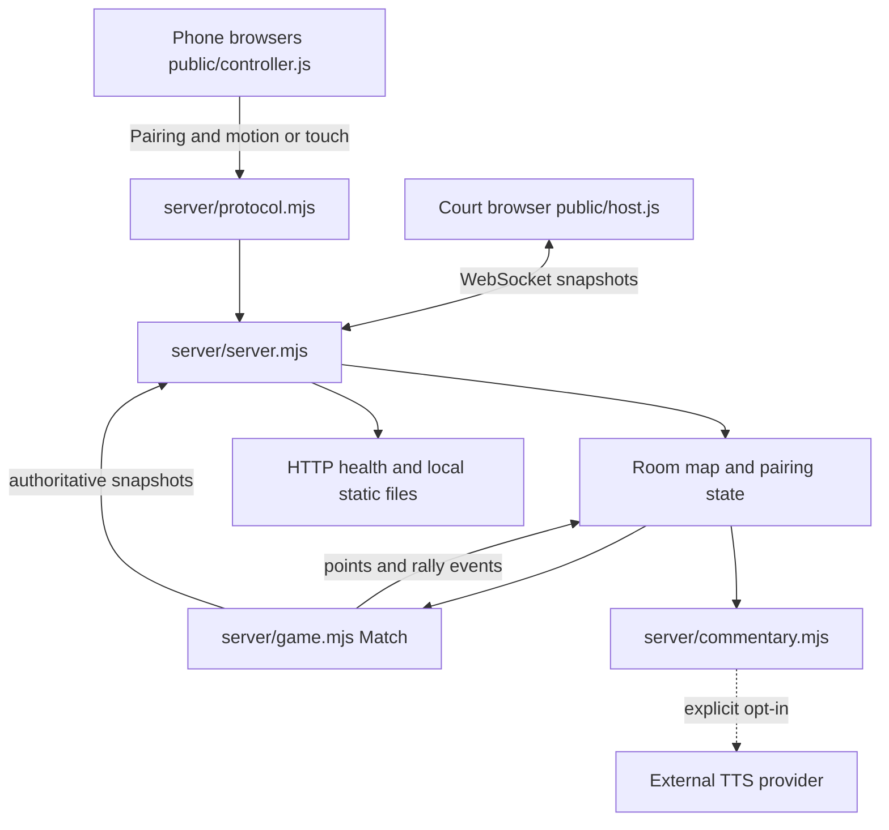
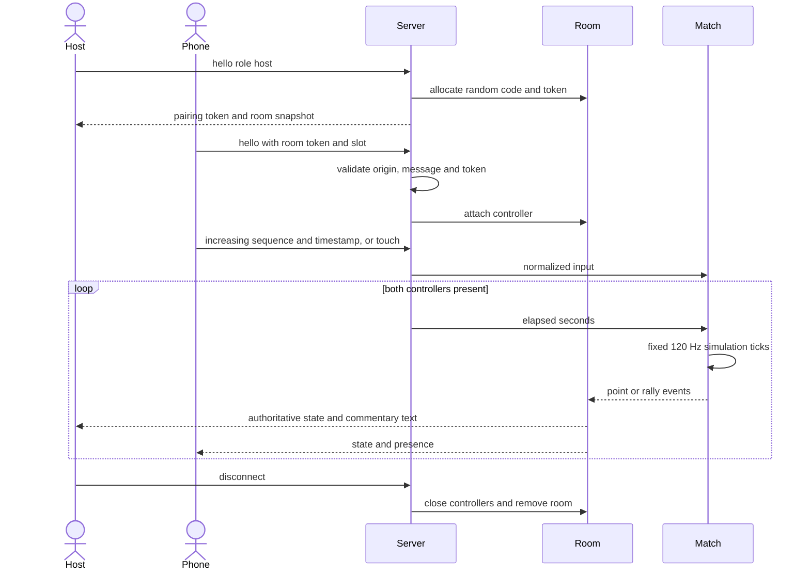

# Motion rally architecture

Reviewed against the local working tree on 2026-11-07. Source paths below are relative to this repository.

## System context and data flow

A local Node HTTP/WebSocket server owns room membership and match physics. One court browser hosts a room and two phone browsers pair through a room code plus token. Phone orientation or touch messages become validated server inputs. Optional commentary uses a separately enabled Gemini adapter; the tests inject a transport and make no provider requests.



## Main execution sequence



## Modules and ownership

- `server/protocol.mjs` owns byte/range/schema checks, pairing message validation, names, random room codes, and calibrated motion normalization.
- `server/game.mjs` owns deterministic seeded serves, 120 Hz fixed-step physics, stale-input neutralization, scoring, and detached snapshots.
- `server/server.mjs` owns HTTP/static serving, upgrade origin checks, 32-room/64-connection limits, room tokens, connection lifecycle, input-rate limits, scheduling, and health stats.
- `server/commentary.mjs` owns explicit enablement, a request budget, single in-flight request, abort timeout, and audio extraction.
- `public/host.js` renders the court and pairing UI. `public/controller.js` manages phone permissions, calibration, transport, and touch fallback.
- `tools/load_test.mjs` and `tools/browser_qa.mjs` provide separate load and browser exercises.

## State and failure handling

The server stores rooms in a Map. Each room owns one Match and controller slots. The server is the score and ball authority. Tokens stay in room/connection memory and are excluded from health output. Motion sequence and timestamps must increase. The physics model accumulates elapsed time in 1/120 second steps and caps catch-up input at 0.25 seconds per call. Physics stops when either controller is absent. The adapter shares a request budget and busy flag across its callers. It clears busy state and the timeout in finally. No durable match storage exists.

## Reproduce the checks

```sh
npm test
npm start
```

The added tests cover in-flight commentary rejection, recovery after HTTP failure and timeout, and the real local HTTP HEAD/method boundary. Provider calls use an injected transport. Browser motion permissions, audio playback, and external provider delivery remain separate checks.
