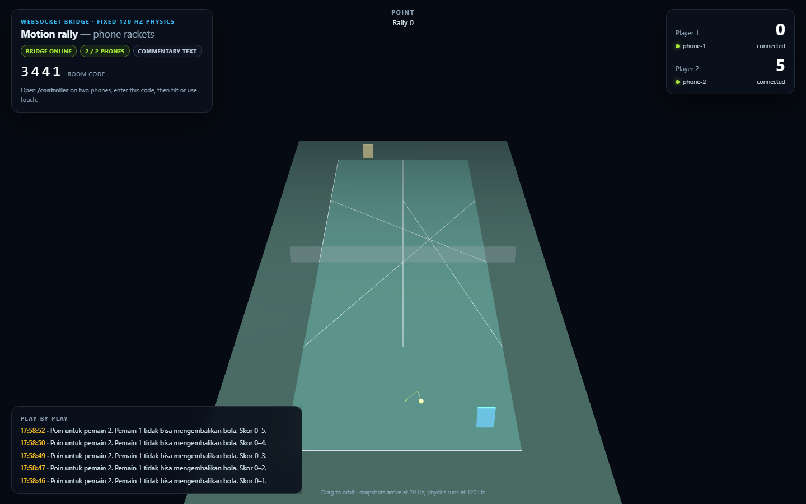
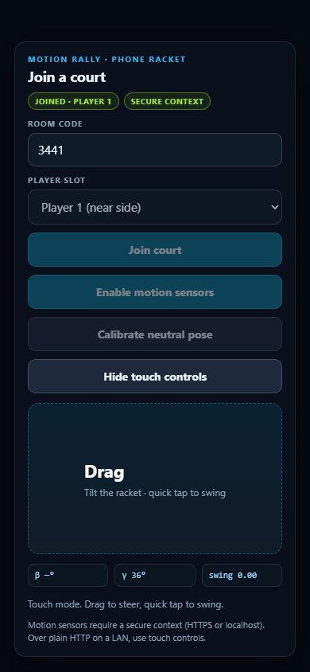

# Motion Rally — two phones, one court, fixed-step physics

A local multi-device game: phones send orientation (or touch) over a WebSocket bridge, a server-authoritative match runs at **120 Hz**, and a desktop page renders the court with three.js. Commentary is generated as text and can optionally be spoken through Gemini TTS when a key is configured.



The physics is deliberately simplified and the sensor path is not calibrated to a real racket. Nothing here claims competitive accuracy, low-latency networking or broadcast-quality commentary.

## Architecture

```
phone A ─┐  input (seq, timestamp, beta, gamma)   ┌─ snapshot 20 Hz ─→ desktop
phone B ─┼──────────── WebSocket ────────────────┤
         │             server (60 Hz loop)        └─ commentary text / optional audio
         └── touch fallback (x, swing)              match physics at 120 Hz
```

- **Server** — `server/server.mjs`: static files, `/ws`, rooms, pairing, rate limits, snapshot loop, `/healthz`.
- **Physics** — `server/game.mjs`: deterministic `Match`, 1/120 s steps, seeded serve generator, no randomness inside a step.
- **Protocol** — `server/protocol.mjs`: schema, ranges, room/slot rules, motion normalisation.
- **Commentary** — `server/commentary.mjs`: text always; audio only with `GEMINI_API_KEY`.
- **Clients** — `public/index.html` (court), `public/controller.html` (phone).

## Run it

Node 22+.

```sh
npm ci
npm start                 # prints the bridge URL, default port 8765
```

Open the printed URL on the desktop, then `http://<lan-ip>:8765/controller` on two phones. Enter the four-digit room code and pick a slot. For motion sensors, the page must be a **secure context** (HTTPS or localhost); over plain HTTP on a LAN the controller says so and offers touch controls.

`npm test` runs the 21 Node tests. `npm run qa` runs the Playwright check with two controllers. `npm run load` writes a local probe to `reports/load.json`.

## Protocol and validation

| Message | Direction | Rules |
| --- | --- | --- |
| `hello` | client → server | `v=1`; role `host`/`controller`; controller needs a 4-digit room and slot 1/2; names sanitised to 24 chars |
| `input` | controller → server | finite `seq`, `timestamp`, `beta`, `gamma`, `alpha` within ±360; sequence must strictly increase; ≤90 messages/s |
| `calibrate` | controller → server | finite neutral `beta`/`gamma` |
| `touch` | controller → server | `x` ∈ [-1, 1], `swing` ∈ [0, 1] |
| `room`, `presence`, `state`, `commentary` | server → client | room code, slot status, 20 Hz snapshot, play-by-play |

Rejected frames carry `{type:"error", code, message}`. Oversized frames (>2 KB), bad JSON, wrong versions, duplicate slots and stale sequences are rejected and counted in `/healthz`; the process keeps running.

## Match rules

- Court 8.23 × 23.77 m, net at 0.914 m, singles width.
- Ball: gravity 9.81 m/s², restitution 0.78, linear drag, hard speed cap, radius 33.5 mm.
- Rackets: lateral position from calibrated tilt, swing from angular rate (motion) or a tap (touch); input older than 750 ms is treated as neutral.
- A return requires the ball to cross the paddle plane within reach **and** swing > 0.25; otherwise the opponent scores. Net and out-of-bounds award the point to the other side.
- Server alternates after each point; the first serve uses a seeded generator so replays are reproducible.

## Stale and disconnect handling

- Input older than 750 ms decays to neutral; `/healthz` marks a controller `stale` after 1.5 s without input.
- A controller disconnect frees its slot and broadcasts presence immediately.
- Host disconnect closes the room, notifies controllers and shuts their sockets.
- The host page reconnects automatically and keeps retrying; the controller shows a closed state instead of pretending to be connected.

## Commentary and TTS

Text commentary is always emitted for points, long rallies, nets and outs. Audio requires a server-side key:

```sh
ENABLE_TTS=1 GEMINI_API_KEY=... npm start
```

Without explicit `ENABLE_TTS=1` and a key the server reports `commentary.enabled=false` and the reason in `/healthz`; **no provider call is attempted** (covered by a test with a fake fetch). With a key, one bounded request is made per event and failures are reported as `tts_*` without blocking the match. No API key is shipped, and no audio was generated during verification.

## Verification

| Check | Result |
| --- | --- |
| `npm test` | 28 passed |
| Deterministic replay | two runs of 600 steps produce identical snapshots |
| Pairing | host + two controllers join; duplicate slot rejected |
| Disconnect / stale | presence updates; host close closes the room |
| Invalid frames | NaN, strings, oversized and bad-version frames rejected without a crash |
| TTS gating | no fetch without a key; fetch called once with a key |
| Browser QA | host + two controllers, touch input applied, 0 console errors |
| QA score observed | 0–5 with commentary entries; paddles at x = 0.80 / −0.60 |
| Local load probe | 107 snapshots in 6 s, gap p50 62.6 ms / p95 70.1 ms; server ticks avg 21.2 ms |
| External assets | none; three.js served locally |

The load probe includes two simulated controllers on loopback and says nothing about Wi-Fi or phone sensor latency.



## Limits

- Motion input is raw `DeviceOrientation`; there is no magnetometer fusion, drift correction or racket calibration beyond a neutral-pose offset.
- Physics is a teaching model: no spin, no ball deformation, no rally-specific aerodynamics, no line-judge challenge.
- The viewer draws the ball larger than life for visibility.
- Controllers require both the room code and a random 128-bit pairing token. Protect the controller URL/token; this is local pairing, not a public authentication service.
- No HTTPS setup is bundled, so iOS motion permission will not appear on plain HTTP.
- No TURN/STUN, no reconnection token, no persistent scores or match history.
- Browser QA uses touch input; real phone motion events were not exercised in CI.

## Provenance and licence

All code and the court model are original for this project. Gemini TTS is optional and disabled by default. No provider response, audio file or API key is included.

MIT — see [LICENSE](LICENSE).

## Crosscheck corrections, 2026-10-19

- CLI now binds `127.0.0.1` by default. Phone access requires an intentional LAN bind, for example `HOST=0.0.0.0`, and a trusted local network. HTTPS remains necessary for phone motion sensors.
- The court displays a 128-bit pairing token and a controller link using a URL fragment. Room codes alone do not grant controller access. Tokens never appear in `/healthz`.
- Cross-origin browser WebSocket upgrades are rejected. Integer sequence numbers and increasing motion timestamps are required.
- Swing rate uses measured sample time instead of assuming every sample arrives after 45 ms. Wraparound uses the shortest angular difference.
- Ambient API credentials cannot activate paid TTS. Explicit opt-in and a key are both required. One request may be in flight, with at most ten requests per server session. Provider traffic was not used during this audit.
- The optional adapter follows the [official Generate Content TTS format](https://ai.google.dev/gemini-api/docs/generate-content/speech-generation). `GEMINI_TTS_MODEL` can select an available model. The default is `gemini-3.8-flash-tts`. API credentials use the request header, not the URL.
- Audio receipt is surfaced honestly. Automatic audio playback is not implemented; text commentary remains the verified path.

The earlier screenshot/load-probe values describe version 0.1.0. Current pairing/security regressions and local UI checks are recorded separately. No hardware sensor or external provider latency claim is made.

## Visual correction in 0.2.1

Court perimeter vertices are emitted as explicit segment pairs, removing accidental diagonal connections. The server waits for both controller slots before advancing match physics or scoring. The UI states that it is waiting. Browser screenshots were refreshed after these corrections.
